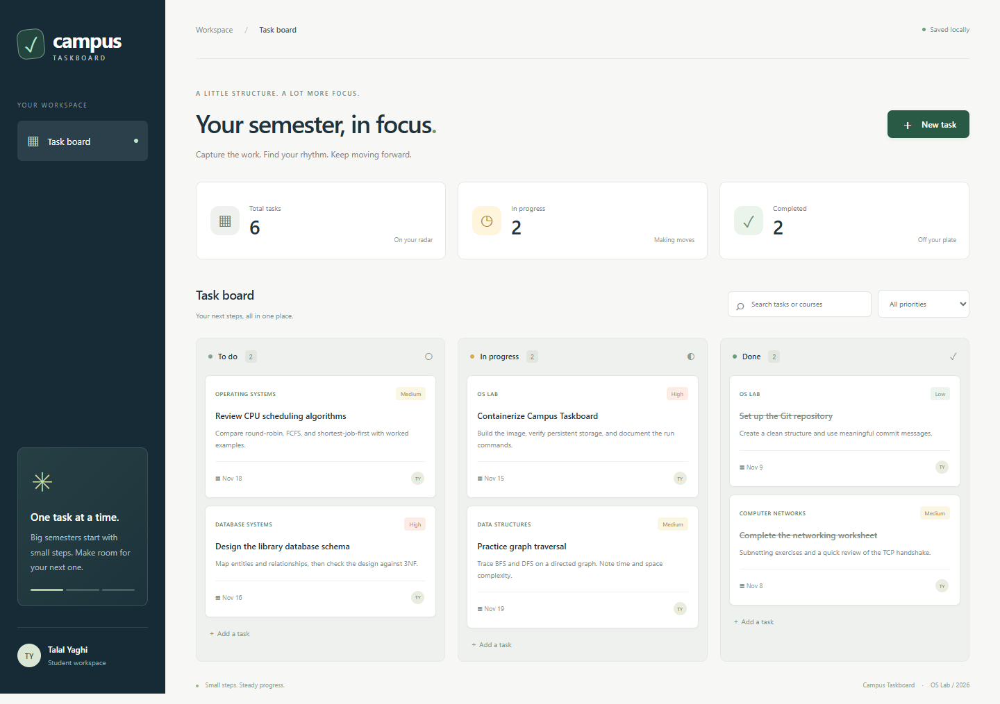

# Campus Taskboard

[](https://github.com/TalalYaghi/Talal-Ismail-Yaghi/actions/workflows/ci.yml)

A focused workspace for university assignments. Plan tasks by course, set priorities and due dates, and move work from **To do → In progress → Done**. Search your board, filter by priority, and keep your tasks between restarts with SQLite storage.

**Author:** Talal Ismail Yaghi · **Course:** OS Lab, Assignment 2 (Docker & GitHub)

**Repository:** [TalalYaghi/Talal-Ismail-Yaghi](https://github.com/TalalYaghi/Talal-Ismail-Yaghi)



## Tech stack

- Python 3.13, Flask 3.1.3 and Gunicorn 26.2.0
- SQLite (included with Python)
- HTML, CSS and vanilla JavaScript; no frontend build tools or CDN assets
- Docker multi-stage build, Docker Compose and GitHub Actions

All direct and transitive Python dependencies are pinned in `requirements.txt`.

## Quick start with Docker Compose

Install [Docker Desktop](https://docs.docker.com/desktop/) or [Docker Engine](https://docs.docker.com/engine/install/) with the Compose plugin, and Git. Ensure Docker is running.

```sh
git clone https://github.com/TalalYaghi/Talal-Ismail-Yaghi.git
cd Talal-Ismail-Yaghi
docker compose up -d --build --wait
```

Open **http://localhost:8088**. A new installation starts with an empty board. No API keys or environment file are required.

```sh
docker compose ps                 # shows running / healthy
docker compose logs -f            # application and access logs; Ctrl+C exits logs
```

### Stop and clean up

```sh
docker compose stop              # stop; keep the container and tasks
docker compose start             # resume it
docker compose down              # remove container and network; keep saved tasks
```

For a **complete reset that deletes all saved tasks**, run `docker compose down -v`. To remove the local image after stopping, run `docker image rm campus-taskboard:latest`.

## Plain Docker alternative

```sh
docker build -t campus-taskboard:latest .
docker volume create campus-taskboard-data
docker run -d --name campus-taskboard -p 127.0.0.1:8088:8000 -v campus-taskboard-data:/app/data campus-taskboard:latest
docker ps
```

Open http://localhost:8088. Stop with `docker stop campus-taskboard` and remove the stopped container with `docker rm campus-taskboard`. The named volume keeps tasks. Run this alternative after stopping the Compose service so the port is free.

## Configuration and persistence

| Setting | Default | Purpose |
| --- | --- | --- |
| Host port | `8088` | Browser/API access, bound to loopback |
| Container port | `8000` | Gunicorn listens on all container interfaces |
| `APP_PORT` | `8088` | Optional Compose host-port override |
| `DATABASE_PATH` | `/app/data/tasks.db` in Docker | SQLite database location |
| Named volume | `taskboard-data` (Compose prefixes the project name) | Keeps the database across container recreation |

To choose another host port, create a local `.env` file containing `APP_PORT=8090`, then run `docker compose up -d`. Open http://localhost:8090. The `.env` file is ignored by Git. When using the smoke/demo scripts on another port, set `BASE_URL` accordingly.

The runtime runs as user `taskboard` (UID 10001), not root. The Dockerfile creates and owns `/app/data` before a fresh named volume is attached. Use named volumes as documented; a custom host bind mount must be writable by UID 10001.

This is a single-user coursework application without login or account isolation. The documented port mapping is local to your computer. All tasks share one database.

## Try the application

1. Click **New task**, enter a title and course, choose a priority and due date, then click **Create task**.
2. Click a task card to edit it. Change its status to **In progress** or **Done**, then save.
3. Search by title, course or notes. Combine search with the priority filter.
4. Refresh the browser or restart the container; saved tasks remain.
5. To remove a task, open its card, click **Delete task**, and confirm.

Optional sample coursework (Python 3 required on the host):

```sh
python scripts/seed_demo.py
```

This adds six clearly defined sample tasks without duplicating existing titles. The application does not insert demo data automatically.

### API examples

```sh
curl http://localhost:8088/health
# {"service":"campus-taskboard","status":"ok"}
curl http://localhost:8088/api/tasks
curl -X POST http://localhost:8088/api/tasks -H "Content-Type: application/json" -d '{"title":"Prepare Docker lab","course":"OS Lab","priority":"high"}'
curl -X PATCH http://localhost:8088/api/tasks/1 -H "Content-Type: application/json" -d '{"status":"done"}'
curl -X DELETE http://localhost:8088/api/tasks/1
```

Replace `1` with the ID returned by creation. These examples use a POSIX shell; on Windows use WSL or `Invoke-RestMethod` with a JSON body.

| Endpoint | Behavior |
| --- | --- |
| `GET /health` | Checks database access and reports readiness |
| `GET /api/tasks` | Lists saved tasks, newest first |
| `POST /api/tasks` | Creates a task; returns 201 |
| `PATCH /api/tasks/<id>` | Edits supplied fields |
| `DELETE /api/tasks/<id>` | Deletes a task; returns 204 |

Validation rejects missing/blank titles, unknown fields, invalid dates and status/priority values. Limits: title 120, course 60 and notes 1000 characters. Missing tasks return 404; invalid JSON or values return 400.

## Tests

Run all seven API/storage tests inside the image without installing Python locally:

```sh
docker compose build
docker compose run --rm --no-deps -v "${PWD}/tests:/app/tests:ro" taskboard python -m unittest discover -s tests -v
```

The command works in Bash/WSL and PowerShell. The tests use temporary databases and do not change your board.

With Python 3.13 installed, test locally:

```sh
python -m venv .venv
# Bash/WSL: source .venv/bin/activate
# PowerShell: .\.venv\Scripts\Activate.ps1
python -m pip install -r requirements.txt
python -m unittest discover -s tests -v
```

For a running container, `python scripts/smoke_test.py` verifies HTTP, create/update/delete and persistence across an actual `docker compose restart`. It briefly restarts the app and cleans up its test task. CI runs this smoke check too.

For local development after installing dependencies:

```sh
python -m flask --app src.app:create_app run --port 8088
```

Stop the Docker service first if it uses that port. Local development stores data in `data/tasks.db`. Gunicorn runs in the Linux container; Flask's development server also works on Windows.

## Convenience commands

With Make installed: `make build`, `make run`, `make stop`, `make logs`, `make test`, `make health`. Run `make build` before `make run` the first time.

With Docker Desktop on Windows: `powershell -File scripts/taskboard.ps1 run` (also accepts `build`, `stop`, `logs`, `test`, `health`).

On this assignment machine, Docker Engine is installed **inside Ubuntu WSL**, so Docker commands run in that Ubuntu shell. Keep the Ubuntu terminal open while viewing the app; WSL may stop after its last user process exits.

## Repository layout

```text
src/                   Flask API, templates, CSS and JavaScript
tests/                 API validation and persistence tests
scripts/               Run helper, smoke test and optional sample data
docs/notes.md          Technical notes and lessons from verification
docs/screenshots/      Assignment evidence
.github/workflows/     Tests, Docker build and container smoke check
Dockerfile             Two-stage, non-root image with healthcheck
docker-compose.yml     One-command startup and persistent named volume
```

## Bonus features

- **A - Compose:** build/run, named storage volume and configurable host port.
- **B - CI:** GitHub Actions tests, builds, waits for health, checks restart persistence.
- **C - Multi-stage:** build wheels separately and install into a clean runtime stage.
- **D - Healthcheck:** `/health` queries SQLite; Docker monitors it every 15 seconds.
- **E - Convenience:** Makefile and PowerShell helper.
- **G - PR workflow:** Docker/CI work developed on `feature/docker-workflow` and merged into `main` through [pull request #1](https://github.com/TalalYaghi/Talal-Ismail-Yaghi/pull/1) after passing CI.

## Assignment evidence

All submission screenshots are in [docs/screenshots](docs/screenshots/). Build and container screenshots display actual command transcripts captured from Ubuntu WSL. The browser, GitHub commit history, merged PR and successful Actions run are captured directly from the working application or GitHub.

## Attribution and license

This project was created for this assignment, with AI coding assistance; it was not forked or copied from an existing application. Flask, Gunicorn and their dependencies retain their own upstream licenses. Project source is available under the [MIT License](LICENSE).

References: [Flask + Gunicorn](https://flask.palletsprojects.com/en/stable/deploying/gunicorn/), [Docker multi-stage builds](https://docs.docker.com/build/building/multi-stage/), [Compose volumes](https://docs.docker.com/reference/compose-file/volumes/).
